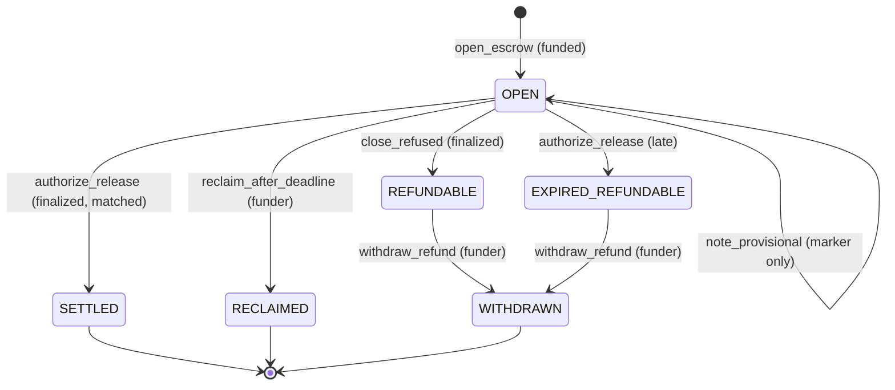

# Vault state machine (v2)

Source of truth: `contracts/v2/finality_vault.py`. The direct-mode suite
`tests/v2/direct/test_state_machine.py` enumerates every edge and every forbidden
edge below, so this document and the code cannot drift without a test failing.

## States

| State | Meaning | Terminal |
| --- | --- | --- |
| `OPEN` | Funded, no closing delivery yet | no |
| `SETTLED` | Released to the recipient on a finalized delivery | yes |
| `REFUNDABLE` | A finalized refusal closed it. The funder may withdraw | no |
| `EXPIRED_REFUNDABLE` | A release delivery arrived after the deadline. The funder may withdraw | no |
| `RECLAIMED` | The funder reclaimed it after the deadline, with no delivery | yes |
| `WITHDRAWN` | The funder withdrew a refund | yes |

`PROVISIONAL_APPROVE` and `PROVISIONAL_REJECT` are not states. They are a display
marker on an `OPEN` escrow and never change what the escrow can do (I5).

## Edges

| From | Event | Sender | Condition | To | Value moves |
| --- | --- | --- | --- | --- | --- |
| (none) | `open_escrow` | funder | value equals amount, deadline in the future, fields equal the gate's action | `OPEN` | in |
| `OPEN` | `note_provisional` | gate | verdict is APPROVE or REJECT | `OPEN` (marker only) | no |
| `OPEN` | `authorize_release` | gate | not late, every field equal, commitment recomputed equal | `SETTLED` | to recipient |
| `OPEN` | `authorize_release` | gate | arrives after `deadline_unix` | `EXPIRED_REFUNDABLE` | no |
| `OPEN` | `close_refused` | gate | none | `REFUNDABLE` | no |
| `OPEN` | `reclaim_after_deadline` | funder | now is after `deadline_unix` | `RECLAIMED` | to funder |
| `REFUNDABLE` | `withdraw_refund` | funder | none | `WITHDRAWN` | to funder |
| `EXPIRED_REFUNDABLE` | `withdraw_refund` | funder | none | `WITHDRAWN` | to funder |

### Recorded no-ops

A gate delivery (`note_provisional`, `authorize_release`, `close_refused`) that
finds the escrow in any state other than `OPEN` returns `status: NOOP`, leaves
the state unchanged and increments `noop_count`. It never transfers value and it
never reverts. This is what makes a duplicate delivery (I4) and the loser of a
release against reclaim race (I11) safe.

## Forbidden edges (each is a test)

| From | Attempt | Required response |
| --- | --- | --- |
| any | `authorize_release`, `close_refused` or `note_provisional` from a non-gate sender | revert `UNAUTHORIZED_SENDER` |
| any | `authorize_release` from the funder, the recipient or the owner | revert `UNAUTHORIZED_SENDER` |
| `OPEN` | `withdraw_refund` | revert `BAD_STATE` |
| `OPEN` | `reclaim_after_deadline` before the deadline | revert `DEADLINE_NOT_PASSED` |
| `OPEN` | `reclaim_after_deadline` by anyone but the funder | revert `NOT_FUNDER` |
| `SETTLED` | `withdraw_refund`, `reclaim_after_deadline` | revert `BAD_STATE` |
| `SETTLED` | any gate delivery | recorded no-op, no second transfer |
| `REFUNDABLE` | `authorize_release` | recorded no-op, never `SETTLED` |
| `REFUNDABLE` | `reclaim_after_deadline` | revert `BAD_STATE` |
| `EXPIRED_REFUNDABLE` | `authorize_release` | recorded no-op, never `SETTLED` |
| `EXPIRED_REFUNDABLE` | `reclaim_after_deadline` | revert `BAD_STATE` |
| `RECLAIMED` | `authorize_release` | recorded no-op, never `SETTLED` (I11) |
| `RECLAIMED` | `withdraw_refund` | revert `BAD_STATE` |
| `WITHDRAWN` | any funder method | revert `BAD_STATE` |
| `WITHDRAWN` | any gate delivery | recorded no-op |
| (none) | `open_escrow` for an existing action | revert `ESCROW_EXISTS` |
| (none) | any method naming an unknown escrow | revert `ESCROW_UNKNOWN` |

## Diagram

## The one asymmetry

Value can leave toward the recipient from exactly one edge (`OPEN` to `SETTLED`),
and that edge requires a delivery from the bound gate. Every other edge that moves
value moves it to the funder. A clock appears only on edges that deny or return
value to the funder, which is what `npm run check:no-clock` verifies.
